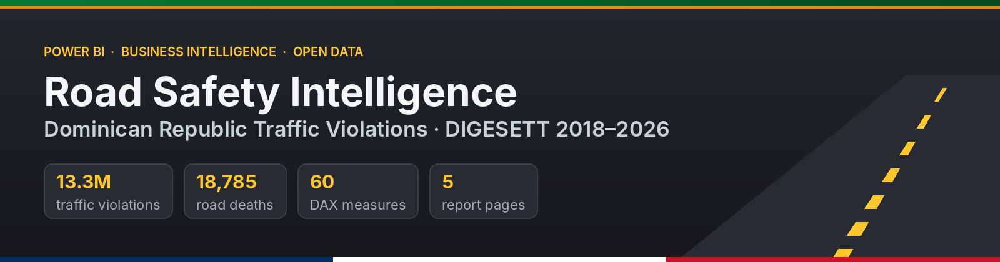
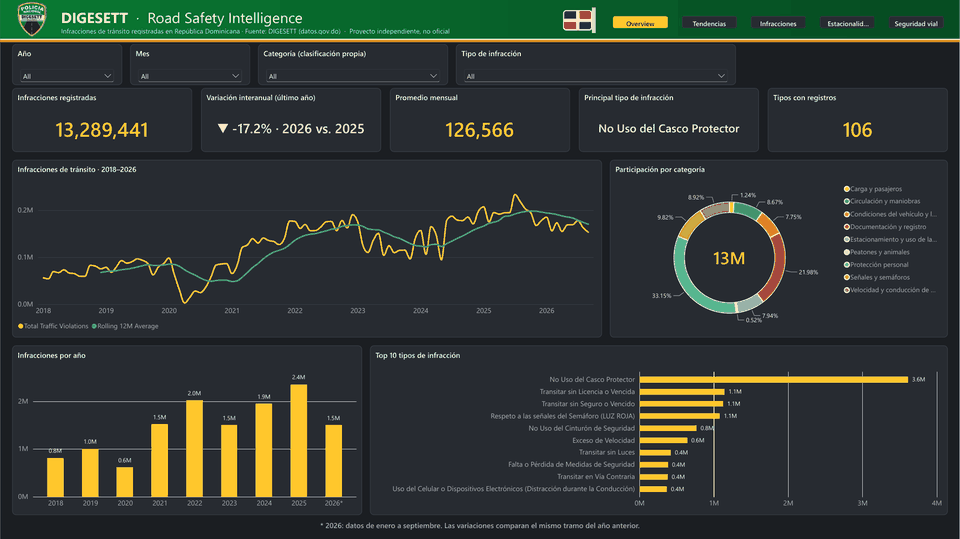
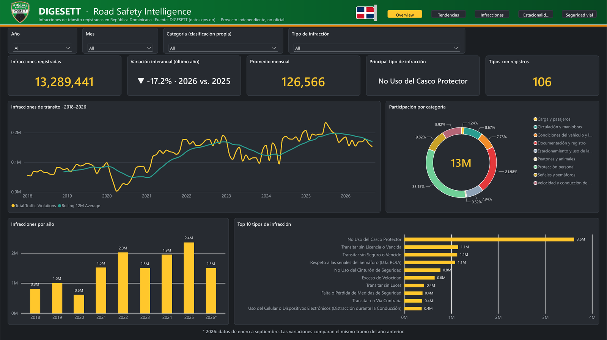
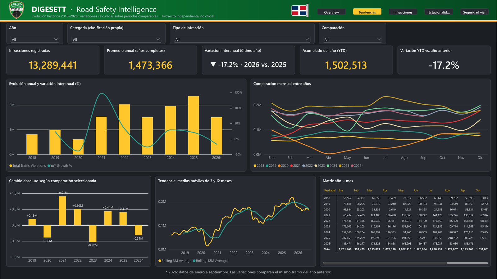
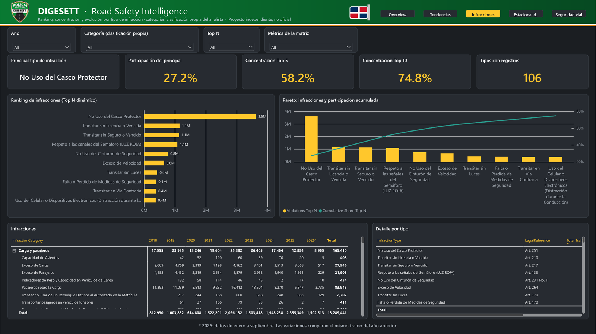
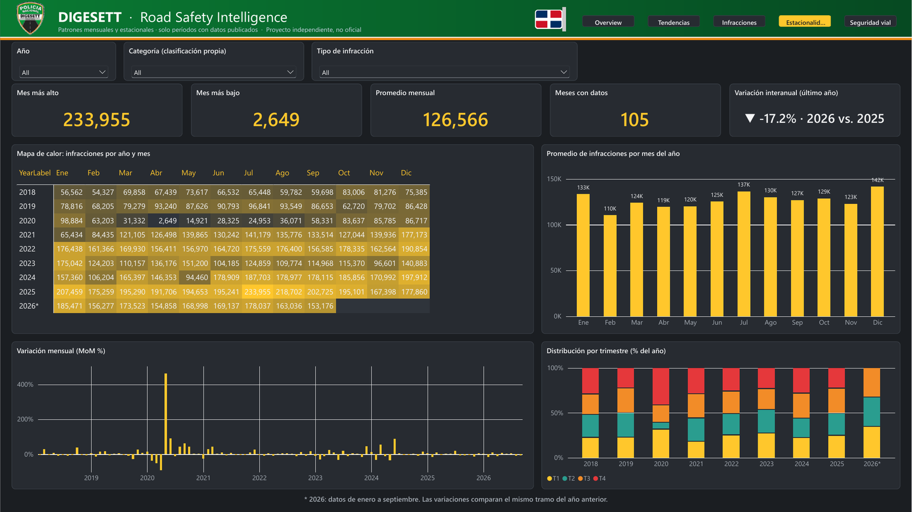
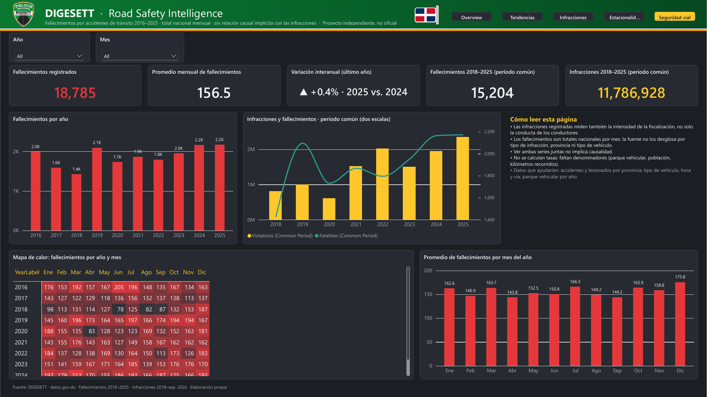
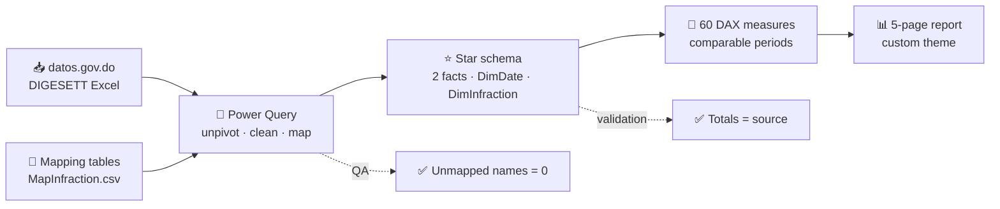
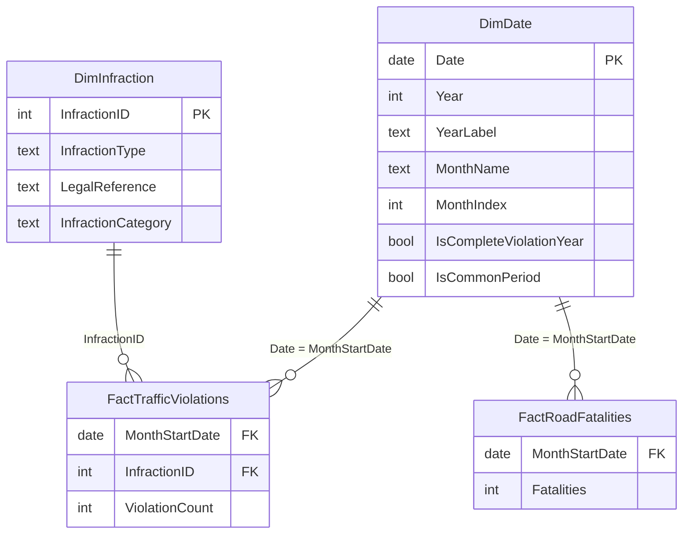

<p align="center">
  
</p>

<p align="center">
  
  
  
  
  
  
</p>

<p align="center">
  <b>A Power BI intelligence platform built on 13.3 million traffic violations and 18,785 road deaths recorded by DIGESETT in the Dominican Republic.</b><br>
  <sub>Power Query ETL · constellation star schema · 60 DAX measures · 5-page report · every total reconciled with the source</sub>
</p>

<p align="center">
  <a href="#-dashboard-tour">Dashboard</a> ·
  <a href="#-key-findings">Findings</a> ·
  <a href="#-how-it-works">How it works</a> ·
  <a href="#-data-model">Data model</a> ·
  <a href="#-run-it-locally">Run it</a> ·
  <a href="docs/README.md">Documentation</a>
</p>

> [!NOTE]
> Independent portfolio project. It is **not** an official DIGESETT product. The DIGESETT name and emblem appear only to credit the data source. Technical documentation is in Spanish, in [`docs/`](docs/README.md).

---

## 🎬 Dashboard tour

<p align="center">
  
</p>

<table>
  <tr>
    <td width="50%" valign="top">
      
      <p><b>1 · Executive Overview</b><br><sub>How many violations, how they evolve, which types dominate. Monthly trend with a 12-month moving average, share by category, yearly totals and Top 10.</sub></p>
    </td>
    <td width="50%" valign="top">
      
      <p><b>2 · Historical Trends</b><br><sub>Which years changed most. Year-over-year on comparable months, YoY / MoM switch, 3- and 12-month moving averages, year × month matrix.</sub></p>
    </td>
  </tr>
  <tr>
    <td width="50%" valign="top">
      
      <p><b>3 · Infraction Analysis</b><br><sub>Which violations concentrate the volume. Dynamic Top N, Pareto, category › type matrix with a metric selector, legal reference detail.</sub></p>
    </td>
    <td width="50%" valign="top">
      
      <p><b>4 · Monthly & Seasonal</b><br><sub>Whether some months or quarters weigh more. Year × month heatmap, average by month, MoM change, quarterly distribution.</sub></p>
    </td>
  </tr>
  <tr>
    <td width="50%" valign="top">
      
      <p><b>5 · Road Safety Insights</b><br><sub>Road deaths 2016–2025, violations vs. deaths on the common period (dual axis, no causal claim), fatality heatmap and reading notes.</sub></p>
    </td>
    <td width="50%" valign="top">
      <h4>🧭 How to use it</h4>
      <ul>
        <li><b>Navigation:</b> the five header buttons switch pages (Ctrl + click in Desktop).</li>
        <li><b>Slicers:</b> Year, Month, Category and Type are synced across pages.</li>
        <li><b>Top N</b> (3–20) drives the ranking and the Pareto.</li>
        <li><b>Metric selector</b> changes the matrix on page 3; <b>Comparison</b> switches YoY / MoM on page 2.</li>
        <li><b><code>2026*</code></b> marks the partial year (Jan–Sep); variations compare the same months.</li>
        <li>Violation filters <b>do not</b> filter deaths: the source has no such breakdown.</li>
      </ul>
      <p>📄 <a href="assets/DIGESETT_Road_Safety_Intelligence.pdf">Full report as PDF</a></p>
    </td>
  </tr>
</table>

---

## 💡 Key findings

| | Finding | Value |
|:-:|---|---:|
| 🏍️ | Not wearing a helmet, share of all violations | **27.2 %** (31.3 % in 2025) |
| 📋 | Top 5 / Top 10 violation types, share of total | **58.2 % / 74.8 %** |
| 📈 | Growth 2021 → 2025 (same catalog) | **+54.7 %** |
| 🚦 | Recorded violations in 2025 (highest year) | **2,355,349** |
| 📉 | Jan–Sep 2026 vs. Jan–Sep 2025 | **−17.2 %** |
| 🕯️ | Road deaths in 2025 (highest in 2016–2025) | **2,172** |
| 📅 | Month with the most violations and deaths on average | **December** |

Twelve business questions are answered in [Business Questions & Insights](docs/business/02_Business_Questions_and_Insights.md), with observations kept separate from hypotheses.

---

## 🧩 Business problem

DIGESETT publishes its data as wide Excel files: one column per month, no indicators, a violations catalog that changes between **2018 (41 types)** and **2019 onward (101 types)**, and unpublished months stored as `0`. Read naively, a violation type looks like it disappears in 2019, and 2026 looks like a 36 % collapse when the real comparable drop is 17 %.

This project turns those files into a model that answers questions correctly by design.

---

## ⚙️ How it works



| Step | What happens | Why it matters |
|---|---|---|
| **1 · Unpivot** | 12 month columns become one period column | One `SUM` measure and real time intelligence |
| **2 · Catalog mapping** | 145 raw names → 106 canonical types through an auditable CSV | 2018 and 2019+ series line up; every mapping has a confidence level |
| **3 · Zero ≠ no data** | Unpublished months and not-yet-recorded types are removed; real zeros are kept | Averages, minimums and variations are not distorted |
| **4 · Constellation model** | Violations and deaths share only `DimDate`; single-direction filters | No double counting and no misleading cross-filtering |
| **5 · Comparable DAX** | YoY compares only months that exist in both years; rolling windows require complete windows | 2026 shows −17.2 %, not −36.2 % |
| **6 · Validation** | Every yearly total and 56 measures checked against an independent Python calculation | Numbers you can defend in a review |

---

## ⭐ Data model



| Table | Grain | Rows |
|---|---|---:|
| `FactTrafficViolations` | violation type × month | 9,580 |
| `FactRoadFatalities` | month (national) | 120 |
| `DimDate` | day, 2016–2026, no day-level attributes exposed | 4,018 |
| `DimInfraction` | canonical violation type | 106 |

---

## 🧮 DAX highlights

```dax
Violations PY Comparable =
VAR LastIdx = [Last Data Month Index]
VAR CurMonths =
    FILTER ( VALUES ( DimDate[MonthIndex] ), DimDate[MonthIndex] <= LastIdx )
VAR PYMonths =
    SELECTCOLUMNS ( CurMonths, "MonthIndex", DimDate[MonthIndex] - 12 )
VAR MonthsCur = [Months with Data]
VAR MonthsPY =
    CALCULATE ( [Months with Data], REMOVEFILTERS ( DimDate ), TREATAS ( PYMonths, DimDate[MonthIndex] ) )
VAR ValuePY =
    CALCULATE ( [Total Traffic Violations], REMOVEFILTERS ( DimDate ), TREATAS ( PYMonths, DimDate[MonthIndex] ) )
RETURN
    IF ( MonthsCur > 0 && MonthsCur = MonthsPY, ValuePY )
```

Returns the previous-year value **only** when both periods have the same months with data. Full catalog: [DAX Measure Catalog](docs/07_DAX_Measure_Catalog.md).

---

## 🛠️ Tech stack

<p align="center">
  
</p>
<p align="center">
  
</p>

| Layer | Tools |
|---|---|
| ETL | Power Query (M), parameterized source path, CSV mapping tables |
| Model | Power BI semantic model in **TMDL**, Import mode, constellation schema |
| Logic | **DAX**: time intelligence, `TREATAS`, `RANKX`, `MonthIndex`-based rolling windows, dynamic format strings |
| Report | **PBIR** report definition, custom JSON theme, institutional header |
| Validation | Python (pandas) control totals, DAX query view |
| Versioning | Git + GitHub (PBIP project format) |

---

## 📁 Repository structure

```
├── DIGESETT_Road_Safety_Intelligence.pbip          ← open in Power BI Desktop
├── DIGESETT_Road_Safety_Intelligence.Report/       ← report (PBIR)
├── DIGESETT_Road_Safety_Intelligence.SemanticModel/← model (TMDL)
├── assets/              ← banner, screenshots, tour GIF, PDF
├── data/
│   ├── raw/             ← DIGESETT source files
│   ├── reference/       ← MapInfraction.csv · DimInfraction.csv
│   └── validation/      ← control totals
├── powerquery/          ← M code, one file per query
├── dax/                 ← measure library
├── model/               ← TMDL scripts
├── theme/               ← Power BI theme JSON
├── scripts/             ← Python profiling
└── docs/                ← documentation (Spanish)
```

---

## 🚀 Run it locally

1. Install **Power BI Desktop** (free) and clone this repository.
2. Open `DIGESETT_Road_Safety_Intelligence.pbip`.
3. *Transform data → Manage parameters → `pRutaDatos`*: set the full path to your `data\` folder, ending in `\`.
4. **Refresh.** Expected totals: **13,289,441** violations and **18,785** deaths.

---

## 📚 Documentation

| Business | Data & model | Report & delivery |
|---|---|---|
| [Business Requirements](docs/business/01_Business_Requirements_Document.md) | [Data profiling & quality](docs/01_Data_Quality_Report_Fase1.md) | [Dashboard design spec](docs/06_Dashboard_Design_Specification.md) |
| [Business questions & insights](docs/business/02_Business_Questions_and_Insights.md) | [Power Query guide](docs/02_Power_Query_Transformation_Guide.md) | [Report user guide](docs/08_Report_User_Guide.md) |
| [Architecture & decisions](docs/05_Architecture_and_Design_Decisions.md) | [Star schema](docs/03_Star_Schema_Documentation.md) | [Testing & validation](docs/09_Testing_and_Validation.md) |
| | [Data dictionary](docs/04_Data_Dictionary.md) | [Deployment & publishing](docs/10_Deployment_and_Publishing_Guide.md) |
| | [DAX measure catalog](docs/07_DAX_Measure_Catalog.md) | |

---

## ⚠️ Limitations

- Recorded violations reflect **enforcement as well as behavior**; a rise does not prove riskier driving.
- Deaths are national monthly totals with no breakdown by violation, province or vehicle. The report shows both series side by side and makes **no causal claim**.
- No exposure data (vehicles, population, distance), so **no rates** are calculated.
- Violation categories are the analyst's own grouping, not an official DIGESETT classification.

---

## 🗺️ Roadmap

- [x] ETL, star schema, 60 DAX measures, 5-page report, validation, documentation
- [ ] Public Power BI link
- [ ] Drill-through, report-page tooltips, bookmarks and reset button
- [ ] Vehicle fleet (DGII) and population (ONE) to compute rates per 10,000 vehicles / 100,000 people

---

## 📊 Data source

DIGESETT — *Estadísticas de infracciones de tránsito* and *Fallecimientos según meses*, published on [datos.gov.do](https://datos.gov.do/dataset/estadisticas-de-infracciones-de-transito).

---

<p align="center">
  <b>Stanly Fernández</b><br>
  <sub>Industrial Engineer · MBA & Master's in Big Data and Business Intelligence</sub><br><br>
  <a href="https://github.com/Stanly06"></a>
  <a href="https://stanly06.github.io"></a>
</p>
