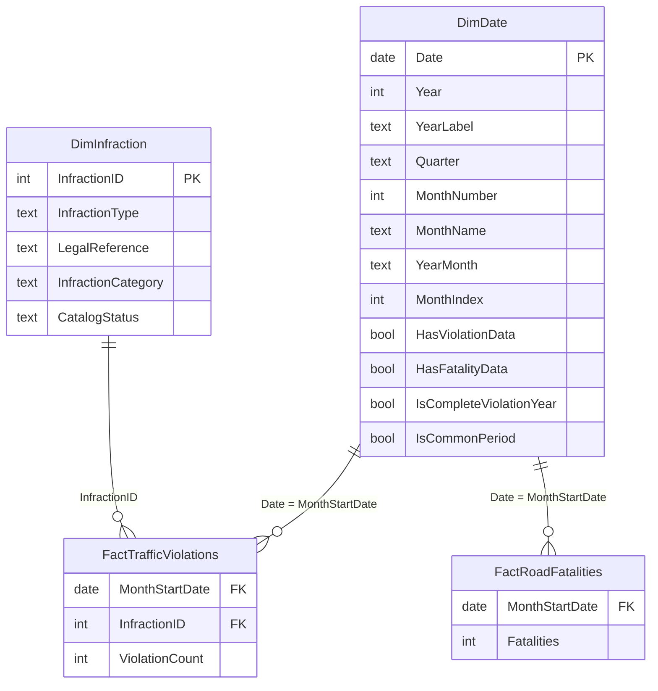

# Fase 3 — Star Schema Documentation

**Proyecto:** Dominican Republic Traffic Violations & Road Safety Intelligence Platform

> **Estado:** modelo **creado y validado en Power BI Desktop el 2026-11-09** (`DIGESETT_Road_Safety_Intelligence.pbix`). Se aplicó con el script `model/DIGESETT_model.tmdl` desde la vista TMDL; tablas, relaciones, jerarquías, orden y columnas ocultas quedaron definidos por ese script. La tabla de la sección 6 coincide con el resultado de la consulta DAX de validación.

---

## 1. Diagrama

Es una **constelación** (dos estrellas que comparten `DimDate`): dos procesos de negocio distintos, con granos distintos, unidos por una dimensión conformada.

---

## 2. Tablas

| Tabla | Rol | Grano | Filas esperadas | Clave |
|-------|-----|-------|----------------:|-------|
| `DimDate` | Dimensión conformada | 1 día | 4,018 | `Date` |
| `DimInfraction` | Dimensión | 1 infracción canónica | 106 | `InfractionID` |
| `FactTrafficViolations` | Hechos | infracción × mes | 9,580 | (`MonthStartDate`, `InfractionID`) |
| `FactRoadFatalities` | Hechos | mes (nacional) | 120 | `MonthStartDate` |
| `_Measures` | Contenedor de medidas | — | 1 | — |

Cobertura dentro de `DimDate`: 105 meses con infracciones (2018-01 a 2026-09), 120 con fallecimientos (2016-01 a 2025-12), **96 meses comunes** (2018-01 a 2025-12).

---

## 3. Relaciones

| # | Desde (lado 1) | Hacia (lado *) | Cardinalidad | Dirección de filtro | Activa |
|---|----------------|----------------|--------------|---------------------|--------|
| 1 | `DimDate[Date]` | `FactTrafficViolations[MonthStartDate]` | 1 : * | Única (dim → hecho) | Sí |
| 2 | `DimDate[Date]` | `FactRoadFatalities[MonthStartDate]` | 1 : * | Única | Sí |
| 3 | `DimInfraction[InfractionID]` | `FactTrafficViolations[InfractionID]` | 1 : * | Única | Sí |

**Relaciones que deliberadamente NO existen:**

- `FactTrafficViolations` ↔ `FactRoadFatalities`. Ambas tienen `MonthStartDate` repetido en infracciones (hasta 101 filas por mes), así que sería muchos-a-muchos y duplicaría fallecidos. Se cruzan a través de `DimDate`.
- `DimInfraction` → `FactRoadFatalities`. La fuente no dice a qué infracción se asocia un fallecimiento. Inventar esa relación sería fabricar información.

---

## 4. Decisiones de diseño

### D1 — Una sola tabla de hechos de infracciones
El brief preveía `FactMonthlyViolations` por si los totales mensuales venían separados de los tipos. No es el caso: la fuente da infracción × mes. El total mensual es `SUM` sobre el mismo hecho. Una tabla menos, sin riesgo de totales que no cuadren entre sí.

### D2 — `DimDate` diaria con hechos mensuales
| Opción | Ventaja | Problema |
|--------|---------|----------|
| Tabla mensual (1 fila/mes) | Refleja el grano real | No es contigua: `DATESYTD`, `SAMEPERIODLASTYEAR`, `DATEADD` no están garantizadas y no se puede marcar correctamente como tabla de fechas |
| **Tabla diaria, sin atributos de día** ✔ | Inteligencia de tiempo estándar funciona; 4,018 filas es insignificante | Requiere disciplina: no exponer el día |

Mitigaciones aplicadas: no existen columnas de día, día de semana ni semana; `Date` queda oculta; la jerarquía termina en Mes. Además se incluye `MonthIndex` para calcular ventanas móviles y MoM por aritmética de índices, independiente de las funciones de tiempo.

### D3 — Dirección de filtro única en todo el modelo
Las dimensiones filtran a los hechos, nunca al revés. Bidireccional entre `DimDate` y los hechos haría que un filtro de infracción llegara a fallecimientos pasando por fechas: exactamente la interacción engañosa que el brief pide evitar.

**Consecuencia que hay que comunicar en el reporte:** al seleccionar una infracción o categoría, las infracciones se filtran y **los fallecimientos no cambian**. Es el comportamiento correcto. En la Fase 4 se añade una medida que detecta el filtro y muestra un aviso en la página 5.

### D4 — Clave sustituta `InfractionID`
El artículo de ley no sirve de clave: Art. 251 cubre tres infracciones, Art. 170 y Art. 239 dos cada uno, y varias no citan artículo. Un entero además comprime mejor que un texto de 80 caracteres repetido 9,580 veces.

### D5 — 2018 sin equivalente como miembros propios de la dimensión
Las 5 infracciones de 2018 sin correspondencia (ID 201–205) son filas reales de `DimInfraction`, con `CatalogStatus = "Solo 2018 (sin equivalente)"`. Alternativas descartadas: eliminarlas (el total de 2018 dejaría de cuadrar con la fuente) o agruparlas en "Otros" (se pierde trazabilidad).

### D6 — Indicadores de cobertura en `DimDate`
`HasViolationData`, `HasFatalityData`, `IsCompleteViolationYear`, `IsCommonPeriod` y `YearLabel` se calculan en Power Query a partir de los hechos. Así las medidas DAX no llevan fechas escritas a mano y el modelo se adapta cuando llegue octubre 2026.

### D7 — Tabla de medidas `_Measures`
Todas las medidas viven en una tabla sin datos. El guion bajo la coloca primera en el panel de campos; las medidas se organizan en carpetas de visualización (Fase 4).

### D8 — Sin columnas calculadas ni tablas calculadas en DAX
Todo lo que es estructura se resuelve en Power Query (se comprime mejor y se calcula una vez en la actualización). DAX queda solo para medidas.

---

## 5. Implementación en Power BI Desktop

> **Vía rápida (la que se usó):** desactivar *Fecha y hora automáticas* (5.1, paso 1), abrir la **vista TMDL**, pegar `model/DIGESETT_model.tmdl`, **Apply** y luego **Refresh now**. Eso equivale a los pasos 5.2 a 5.8. Los pasos manuales se conservan como referencia y para explicar cada ajuste.

> `DimDate` lee la cobertura desde `stg_Infracciones` y `stg_Fallecimientos` (staging), no desde las tablas cargadas.

### 5.1 Antes de cargar
1. **Archivo > Opciones > Archivo actual > Carga de datos**: desmarca **Fecha y hora automáticas**. Si no, Power BI crea una tabla de fechas oculta por cada columna de fecha: infla el modelo y compite con `DimDate`.
2. En Power Query, crea la consulta `DimDate` pegando `powerquery/07_DimDate.pq`. Si aparece un aviso de *Formula.Firewall*, ve a **Opciones > Archivo actual > Privacidad** y marca los orígenes como *Organizacional*.
3. **Cerrar y aplicar**.

### 5.2 Tabla de medidas
**Inicio > Especificar datos** → deja una columna cualquiera → nombre de tabla `_Measures` → Cargar. En la Fase 4, al crear la primera medida, se oculta esa columna y la tabla pasa a mostrarse con icono de medidas.

### 5.3 Relaciones (Vista de modelo)
Si Power BI creó relaciones automáticas, bórralas y crea las tres de la sección 3 arrastrando el campo del lado *1* sobre el del lado *\**. Verifica en cada una: cardinalidad **Uno a varios**, dirección **Única**.

### 5.4 Marcar la tabla de fechas
Selecciona `DimDate` → **Herramientas de tablas > Marcar como tabla de fechas** → columna `Date`.

### 5.5 Ordenar por columna
| Columna | Ordenar por |
|---------|-------------|
| `DimDate[MonthName]` | `MonthNumber` |
| `DimDate[MonthNameShort]` | `MonthNumber` |
| `DimDate[Quarter]` | `QuarterNumber` |
| `DimDate[YearMonth]` | `YearMonthSort` |
| `DimDate[YearLabel]` | `Year` |

Sin esto, los meses salen en orden alfabético (Abril, Agosto, Diciembre…).

### 5.6 Resumen predeterminado
Pon **No resumir** en: `Year`, `MonthNumber`, `QuarterNumber`, `YearMonthSort`, `MonthIndex`, `InfractionID`. Evita que Power BI sume años al arrastrarlos a un visual.

### 5.7 Ocultar en la vista de informe
| Tabla | Columnas a ocultar | Motivo |
|-------|--------------------|--------|
| `FactTrafficViolations` | `MonthStartDate`, `InfractionID` | Claves: el usuario debe filtrar por la dimensión |
| `FactTrafficViolations` | `ViolationCount` | Tras crear las medidas (Fase 4): obliga a usar medidas, no agregados implícitos |
| `FactRoadFatalities` | `MonthStartDate`, `Fatalities` | Ídem |
| `DimDate` | `Date`, `MonthStartDate`, `MonthNumber`, `QuarterNumber`, `YearMonthSort`, `MonthIndex` | Técnicas / de ordenación |
| `DimInfraction` | `InfractionID` | Clave sustituta |

### 5.8 Jerarquías
- `DimDate` → **Calendario**: `Year` › `Quarter` › `MonthName`
- `DimInfraction` → **Infracción**: `InfractionCategory` › `InfractionType`

### 5.9 Categorías de datos y formato
- `ViolationCount`, `Fatalities`: número entero, separador de miles.
- `DimDate[Date]`, `MonthStartDate`: formato `mmm yyyy`.

---

## 6. Validación del modelo

Crea una tabla visual temporal con `DimDate[Year]` y la **suma** de `ViolationCount` y de `Fatalities`:

| Year | ViolationCount | Fatalities |
|------|---------------:|-----------:|
| 2016 | (en blanco) | 1,993 |
| 2017 | (en blanco) | 1,588 |
| 2018 | 812,930 | 1,427 |
| 2019 | 1,003,852 | 2,095 |
| 2020 | 614,808 | 1,732 |
| 2021 | 1,522,201 | 1,867 |
| 2022 | 2,026,132 | 1,795 |
| 2023 | 1,503,418 | 1,952 |
| 2024 | 1,948,238 | 2,164 |
| 2025 | 2,355,349 | 2,172 |
| 2026 | 1,502,513 | (en blanco) |
| **Total** | **13,289,441** | **18,785** |

Comprobaciones adicionales:

| Prueba | Resultado esperado |
|--------|--------------------|
| Filas de `DimDate` | 4,018 |
| Filtrar `InfractionCategory` = "Protección personal" | Cambian las infracciones; **fallecimientos no cambian** |
| Suma de `ViolationCount` por `InfractionCategory` | Los 9 grupos suman 13,289,441 (ninguna fila en blanco) |
| Fila en blanco en `DimInfraction` o `DimDate` dentro de un visual | No debe aparecer (indicaría claves huérfanas) |
| `YearLabel` | 2026 aparece como `2026*` |

Si la tabla coincide, el modelo está listo para la Fase 4.

---

## 7. Tamaño y rendimiento esperados

Modelo de ~13,800 filas en total, modo Importación. A esta escala el rendimiento no es un riesgo; las buenas prácticas (estrella, claves enteras, filtros unidireccionales, sin columnas calculadas, sin fecha automática) se aplican porque son lo que se evalúa en una entrevista y lo que hace que el mismo diseño escale.
