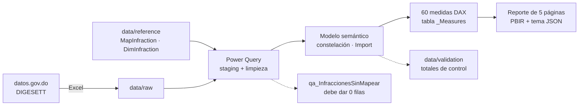

# Arquitectura y decisiones de diseño

## Dominican Republic Traffic Violations & Road Safety Intelligence Platform

---

## 1. Arquitectura

| Capa | Tecnología | Artefacto |
|---|---|---|
| Fuente | Excel de DIGESETT | `data/raw/` |
| Referencia | CSV mantenidos a mano | `data/reference/` |
| ETL | Power Query (M) | `powerquery/*.pq` |
| Modelo | Power BI semantic model en TMDL | `*.SemanticModel/definition/` |
| Lógica de negocio | DAX | `dax/DIGESETT_Measures.dax` |
| Presentación | Reporte PBIR, tema JSON | `*.Report/`, `theme/` |
| Validación | Python + consultas DAX | `scripts/`, `data/validation/` |

---

## 2. Registro de decisiones (ADR)

| # | Decisión | Alternativas descartadas | Motivo |
|---|---|---|---|
| D01 | **Una sola tabla de hechos de infracciones** al grano infracción × mes | Hechos mensuales separados de los anuales | La fuente ya trae el detalle mensual por tipo; una tabla evita totales que no cuadren |
| D02 | **Unpivot** de los 12 meses | Medidas por columna de mes | Permite una sola medida `SUM` y relacionar con una tabla de fechas |
| D03 | **Tabla de mapeo en CSV** para unificar catálogos | 45 `Table.ReplaceValue` encadenados | Auditable, versionable en Git y editable sin tocar M |
| D04 | `LeftOuter` + consulta `LeftAnti` de control | `Inner` join | Un nombre nuevo no desaparece en silencio |
| D05 | **Cero real ≠ sin dato**: se eliminan las filas de períodos no publicados | Dejar los ceros | Los ceros falsos distorsionan promedios, mínimos y variaciones |
| D06 | Corte del último mes **calculado** (`List.Max`) | Fecha escrita a mano | El modelo se ajusta solo cuando se publica un mes nuevo |
| D07 | **Constelación**: dos hechos unidos solo por `DimDate` | Relación entre hechos | Las granularidades son distintas; una relación directa duplicaría fallecimientos |
| D08 | **Filtros unidireccionales** | Bidireccionales | Un filtro de infracción no debe llegar a fallecimientos |
| D09 | `DimDate` **diaria sin atributos de día** | Tabla mensual | La inteligencia de tiempo de DAX necesita fechas contiguas; no se expone un nivel que la fuente no tiene |
| D10 | `MonthIndex` para ventanas móviles y MoM | `DATEADD` sobre fechas | Aritmética simple y robusta en datos mensuales |
| D11 | Variación interanual sobre **meses comparables** | `SAMEPERIODLASTYEAR` directo | Evita comparar un año parcial con uno completo |
| D12 | **Clave sustituta** `InfractionID` | Artículo de ley | Un artículo cubre varias infracciones (Art. 251: tres) |
| D13 | Categorías **propias y rotuladas** | No categorizar / inventar severidad | El brief pide categoría; la fuente no la trae; no existe severidad oficial |
| D14 | ETL en Power Query; **sin columnas calculadas** | DAX calculado | Mejor compresión; cálculo una vez por actualización |
| D15 | Formato **PBIP** (TMDL + PBIR) | Solo `.pbix` | Diferencias legibles en Git, revisión por partes y automatización |
| D16 | Colores **neutros** para aumentos/descensos de infracciones | Rojo = aumento | Más infracciones registradas puede significar más control, no más riesgo |
| D17 | Medidas de **presentación** (`Latest Year YoY Label`, `Partial Period Note`) | Texto fijo | Las tarjetas y notas se adaptan a la selección |

---

## 3. Riesgos y mitigaciones

| Riesgo | Mitigación |
|---|---|
| DIGESETT cambia el nombre de una infracción | `qa_InfraccionesSinMapear` lo detecta |
| DIGESETT agrega columnas o cambia el nombre de la hoja | La navegación por nombre de hoja falla con error visible |
| Un mes no reconocido en fallecimientos | `#date` falla con error visible (no se fecha mal en silencio) |
| Lectura causal infracciones → fallecimientos | Nota de lectura en la página 5; sin línea de tendencia ni coeficiente en el reporte |
| Interpretación de categorías como oficiales | Rótulo "clasificación propia" en segmentadores, subtítulos y documentación |
| Confusión con un producto oficial | Leyenda "Proyecto independiente, no oficial" en todas las páginas |

---

## 4. Rendimiento

| Aspecto | Valor |
|---|---|
| Filas totales | ~13,800 |
| Modo | Importación |
| Claves | Enteras y de fecha |
| Columnas de texto en hechos | Ninguna |
| Fecha y hora automáticas | Desactivadas |
| Columnas calculadas | Ninguna |

A esta escala el rendimiento no es un riesgo; las prácticas se aplican porque son las que escalan.
